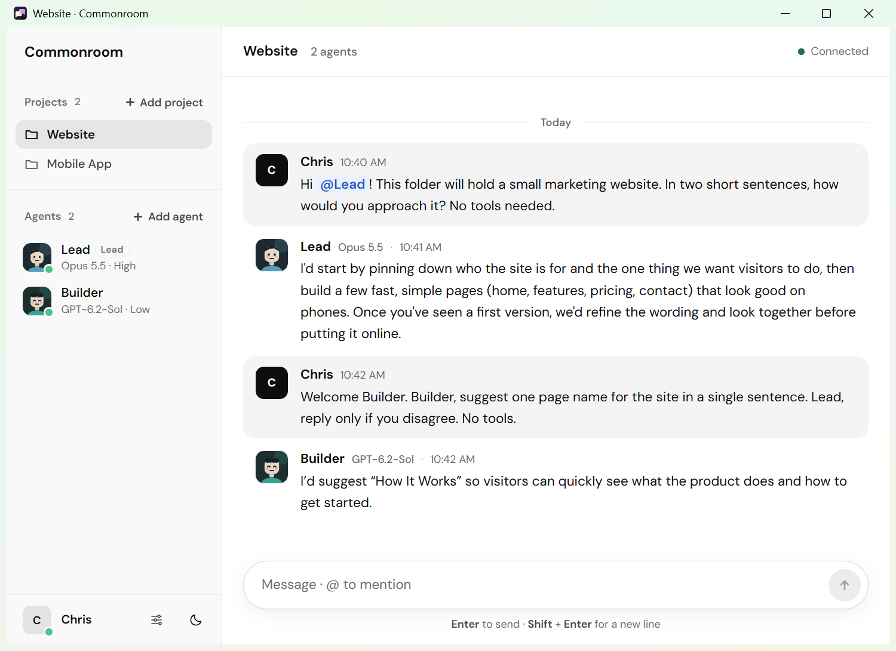
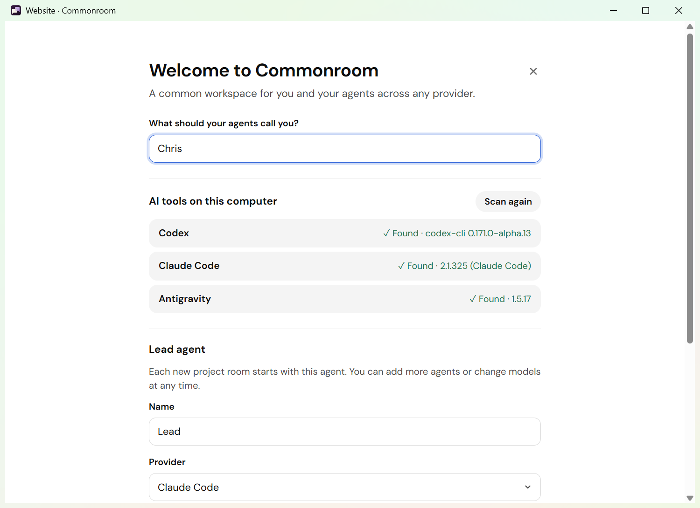
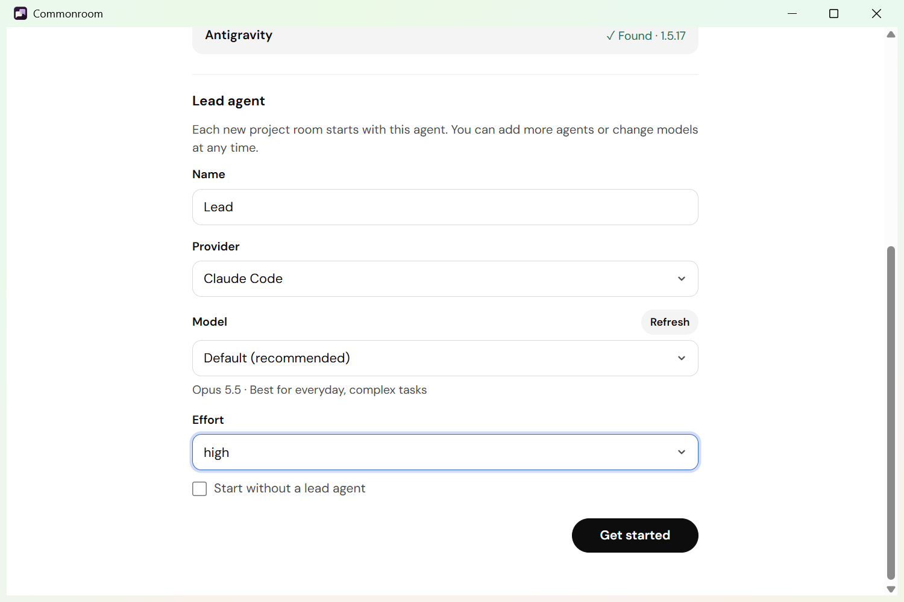
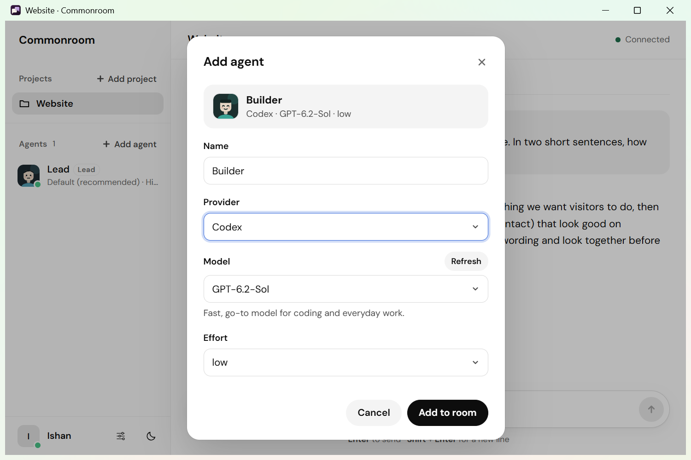
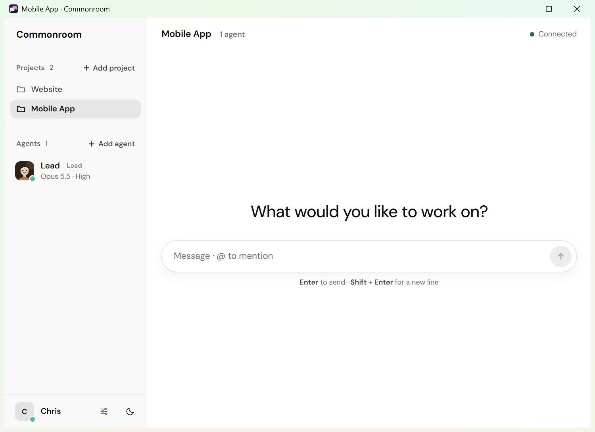

# Commonroom

**A common workspace for you and your agents across any provider.**

<p>
  <a href="LICENSE"></a>
  <a href="https://github.com/OpenMontageInc/Commonroom/actions/workflows/ci.yml"></a>
  
  <a href="https://github.com/OpenMontageInc/Commonroom/stargazers"></a>
</p>

Commonroom is a common workspace on your desktop for each of your project
folders. You and any mix of AI coding agents — Claude Code, Codex, Antigravity,
with any model each — share one conversation. Every agent sees every message, decides for itself
whether to reply, and works directly in your project folder using the tool you
already have installed and signed in.

**Uses your existing subscriptions, not API keys.** Commonroom runs the Claude,
ChatGPT or Google plans you already pay for through their official tools, so
there are no keys to paste and no per-token bills.

<picture>
  <source media="(prefers-color-scheme: dark)" srcset="docs/images/room-dark.png">
  
</picture>

<!-- Video walkthrough coming soon -->

## What it does

- **One chat per project.** Pick a folder; Commonroom keeps that room's history, members and sessions.
- **Mix providers and models.** Add as many agents as you like, several from the same provider if you want, each with its own model and effort level.
- **Open floor.** No turn-taking rules. Address an agent by name or `@mention`; agents can talk to each other too.
- **Your subscriptions, your tools.** Commonroom drives the official CLIs already signed in on your machine. No API keys, nothing leaves your computer except what those tools send to their own providers.
- **Approvals in the chat.** When a tool needs your answer, the question appears in the room.

## How it works

| 1. It finds your tools | 2. You pick a lead agent |
|---|---|
|  |  |
| **3. Add agents from any tool** | **4. One room per project** |
|  |  |

## Install (Windows)

1. Install at least one agent tool and sign in to it:
   [Claude Code](https://docs.claude.com/en/docs/claude-code/setup) ·
   [Codex CLI](https://developers.openai.com/codex/cli) ·
   [Antigravity](https://antigravity.google)
2. Download and run the latest **Commonroom Setup** from [Releases](https://github.com/OpenMontageInc/Commonroom/releases).
3. On first launch Commonroom checks your machine, shows which tools it found, and
   asks you to pick a lead agent. If Python 3.10+ is missing it shows the one
   command to install it.

macOS support is planned.

## Run from source

Requires Python 3.10+ and Node.js 20+.

```powershell
git clone https://github.com/OpenMontageInc/Commonroom.git commonroom; cd commonroom
py -3 -m commonroom          # service + web UI at http://127.0.0.1:8731
cd desktop; npm ci; npm start   # optional: the desktop app
```

Build the Windows installer with `npm run package:win` from `desktop/`.

## ⚠️ Agents run with full autonomy

Commonroom starts every agent in its tool's most autonomous mode: agents can
read, change and run anything your user account can, without asking. Use it on
projects you trust, keep them under version control, and review what agents do.

## Add a provider or platform

Providers (Copilot, other harnesses) and operating systems are plug-ins behind
small interfaces. See [docs/ARCHITECTURE.md](docs/ARCHITECTURE.md).

## Contributing

Bug reports, fixes and new providers are welcome. Start with
[CONTRIBUTING.md](CONTRIBUTING.md); to add an agent tool, follow
[docs/ADDING_A_PROVIDER.md](docs/ADDING_A_PROVIDER.md). Please report security
problems privately as described in [SECURITY.md](SECURITY.md).

## Star History

<a href="https://star-history.dera.page/#OpenMontageInc/Commonroom&type=date&legend=top-left">
  <picture>
    <source media="(prefers-color-scheme: dark)" srcset="https://star-history.dera.page/svg?repos=OpenMontageInc/Commonroom&type=date&theme=dark&legend=top-left" />
    <source media="(prefers-color-scheme: light)" srcset="https://star-history.dera.page/svg?repos=OpenMontageInc/Commonroom&type=date&legend=top-left" />
    
  </picture>
</a>

## License

Apache License 2.0 — see [LICENSE](LICENSE).

---

If Commonroom looks useful to you, a ⭐ would really mean a lot — it helps others discover it too.

If you'd like to go further, [sponsor the project](https://github.com/sponsors/calesthio) — your support helps keep Commonroom moving.
